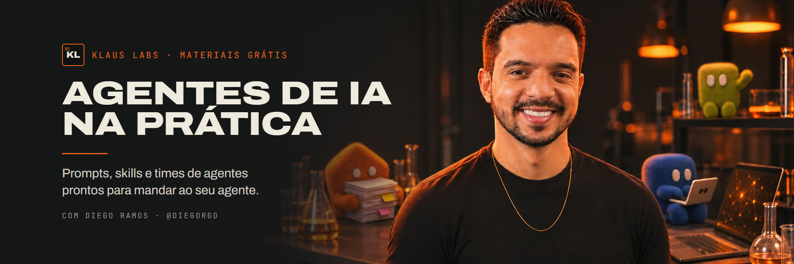
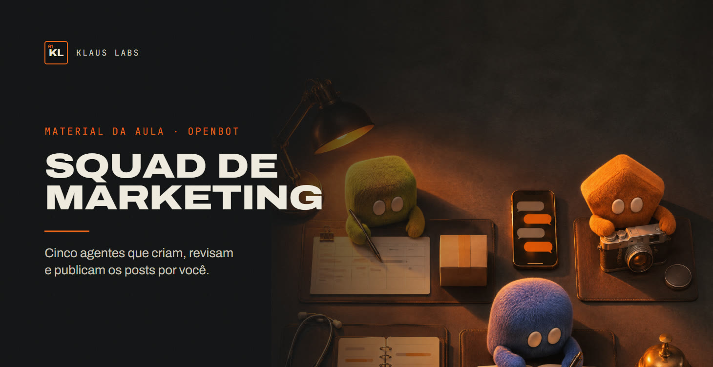

# Klaus Labs · agentes de IA na prática

Materiais grátis de **Diego Ramos**, especialista em inteligência artificial, desenvolvedor de agentes e de times de agentes (squads). Diego é dono do canal [@diegorgo no YouTube](https://www.youtube.com/channel/UCHXHRdd6Sp3Cd7poovCBbew) e fundador da Klaus Agência, uma agência de marketing que opera com IA.

Aqui ficam os arquivos que acompanham os vídeos e a comunidade. Tudo pronto para colar no seu agente ou mandar por link.

---

## O que tem aqui

### 1. Arquiteto de Agentes

**Um agente que cria outros agentes para o seu negócio.** Ele conversa com você, faz no máximo 8 perguntas (o que você vende, qual tarefa quer tirar das suas costas, onde o agente vai rodar, o que ele nunca pode fazer) e entrega um agente pronto: o prompt completo, o que você precisa trocar, 3 mensagens de teste e um checklist antes de colocar na frente do cliente.

Serve para qualquer ramo: atendente de WhatsApp, prospector, gerador de proposta, social media, organizador de agenda. Funciona no ChatGPT, no Claude, no Gemini, no Claude Code, no Hermes e no OpenBot.

- Pasta: [arquiteto-de-agentes](arquiteto-de-agentes)
- Link para mandar ao seu agente: `https://raw.githubusercontent.com/dilandia/klaus-labs/main/arquiteto-de-agentes/arquiteto-de-agentes/SKILL.md`

### 2. Squad de marketing no OpenBot

**Um time de 5 agentes que cuida do Instagram.** Um agente coordenador (o Maestro) lê o blueprint e monta sozinho o canal, as skills e os agentes: o Estrategista escolhe o post, o Redator escreve, o Diretor de Arte cria a imagem, o Revisor de Marca confere e o Publicador publica depois do seu ok. É o material da [aula no YouTube](https://youtu.be/22dHRokZLxo).

- Pasta: [squad-openbot-video-07](squad-openbot-video-07)
- Link para mandar ao Maestro: `https://raw.githubusercontent.com/dilandia/klaus-labs/main/squad-openbot-video-07/02-BLUEPRINT-SQUAD-INSTAGRAM.md`

### 3. Segundo Cérebro

**A memória permanente do seu agente.** Uma pasta com poucos arquivos de texto que o agente lê no começo de toda conversa e atualiza no fim: quem é você, o que o negócio vende, o que está em andamento e os erros que ele não pode repetir. Ele para de esquecer e fica mais afiado no seu negócio a cada semana. Presente dos 100 membros da comunidade gratuita.

Funciona no OpenBot, Hermes, Claude Code, Codex, Cursor, Gemini CLI, ChatGPT, Claude e Gemini.

- Pasta: [segundo-cerebro](segundo-cerebro)
- Link para mandar ao seu agente: `https://raw.githubusercontent.com/dilandia/klaus-labs/main/segundo-cerebro/segundo-cerebro/SKILL.md`

---

## Como usar com o seu agente (sem baixar nada)

Quem usa OpenBot, Hermes ou Claude Code pelo navegador nem sempre consegue arrastar um zip ou um PDF. Por isso cada material tem um **link direto**. Copie o link e mande para o agente, por exemplo:

> Instale como skill o arquivo deste link: (cole o link aqui)

O agente lê o arquivo e faz o resto. Se você usa ChatGPT, Claude ou Gemini, abra o arquivo, copie o texto e cole numa conversa nova.

---

## Comunidade gratuita

Na comunidade gratuita você recebe o Arquiteto de Agentes de presente, as aulas de instalação passo a passo, o material de cada vídeo do canal e um espaço para tirar dúvidas e mostrar o agente que montou.

**Entrar:** https://klauslabs.com.br/grupo

## Klaus Labs PRO (comunidade paga)

Para quem quer ir além do grátis. No PRO você encontra a biblioteca de agentes e skills prontas para usar, times de agentes explicados passo a passo e conteúdo novo toda semana. O plano anual inclui os minicursos e o Socorro Técnico, com ajuda direta nas suas dúvidas de instalação.

**Planos:** https://klauslabs.com.br

---

Canal no YouTube: [@diegorgo](https://www.youtube.com/channel/UCHXHRdd6Sp3Cd7poovCBbew) · Comunidade gratuita: [klauslabs.com.br/grupo](https://klauslabs.com.br/grupo) · Klaus Labs PRO: [klauslabs.com.br](https://klauslabs.com.br)
