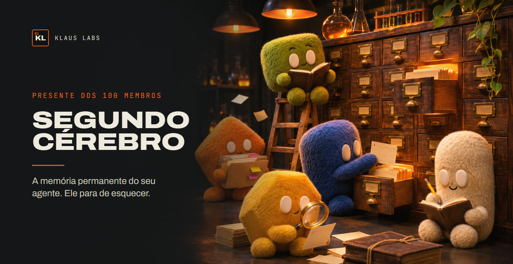

# Segundo Cérebro

**A memória permanente do seu agente de IA.** Uma pasta com poucos arquivos de texto que o agente lê no começo de toda conversa e atualiza no fim. Ele para de esquecer quem você é, o que o seu negócio faz e onde vocês pararam.

Presente de comemoração dos **100 membros** da comunidade gratuita Klaus Labs. É a versão enxuta do segundo cérebro que o Diego Ramos usa todo dia com o Claude Code e com o time de agentes no OpenBot.

---

## O problema que ele resolve

Toda conversa nova com uma IA começa do zero. Você explica de novo o preço, o tom de voz, o cliente difícil e o que ela errou da última vez. Com o Segundo Cérebro, a memória sai da cabeça da IA e vai para arquivos que **são seus**: você vê, corrige e leva para qualquer ferramenta.

| Sem cérebro | Com cérebro |
|---|---|
| "Qual é o seu negócio? Que tom prefere?" | "Da última vez ficou faltando o carrossel de depoimentos. Faço esse, no tom de sempre?" |

## Como funciona

**ABRIR → TRABALHAR → SALVAR.** No começo o agente lê quem é você, o negócio, o que está em andamento e os erros que não pode repetir. No fim ele atualiza o "agora", registra a sessão e guarda as regras novas. Três frases para decorar:

- **"monta meu segundo cérebro"** (uma vez)
- **"abre meu cérebro"** (começo da conversa)
- **"salva"** (fim da conversa)

## O que tem na pasta do cérebro

| Arquivo | Para quê |
|---|---|
| `CEREBRO.md` | Manual do agente: as regras de abrir, salvar e organizar |
| `EU.md` | Quem é você e como gosta de trabalhar |
| `NEGOCIO.md` | O que vende, para quem, tom de voz e regras da casa |
| `AGORA.md` | O que está em andamento e pendente (o mais importante) |
| `APRENDIZADOS.md` | Erros que não se repetem e jeitos certos de fazer |
| `FERRAMENTAS.md` | Ferramentas e onde fica cada coisa (nunca senhas) |
| `memoria/` | Sessões, decisões e pessoas |
| `CLAUDE.md`, `AGENTS.md`, `GEMINI.md` | Fazem Claude Code, Codex, Cursor e Gemini CLI lerem o cérebro sozinhos |

## Funciona em todas as ferramentas

OpenBot · Hermes · Claude Code · Codex · Cursor · Windsurf · Gemini CLI · ChatGPT (Projetos) · Claude.ai (Projetos) · Gemini (Gems) · até Notion e Google Docs.

Passo a passo de cada uma: [COMO-INSTALAR.md](COMO-INSTALAR.md) e o guia em PDF.

## Como usar com o seu agente (sem baixar nada)

Mande para o seu agente (OpenBot, Hermes, Claude Code):

> Instale como skill o arquivo deste link: https://raw.githubusercontent.com/dilandia/klaus-labs/main/segundo-cerebro/segundo-cerebro/SKILL.md

Depois peça: **"monta meu segundo cérebro"**. Ele faz 8 perguntas e cria tudo.

ChatGPT, Claude.ai ou Gemini no navegador: cole o texto de [versoes/instrucoes-navegador.md](versoes/instrucoes-navegador.md) nas instruções do Projeto ou do Gem.

## Arquivos

| Arquivo | O que é |
|---|---|
| [Segundo-Cerebro-Guia.pdf](Segundo-Cerebro-Guia.pdf) | Guia completo (16 páginas) |
| [Segundo-Cerebro-Arquivos.zip](Segundo-Cerebro-Arquivos.zip) | Tudo em um zip |
| [segundo-cerebro/SKILL.md](segundo-cerebro/SKILL.md) | A skill: monta, abre, salva e faz faxina |
| [modelo/](modelo) | O cérebro pronto para copiar e preencher |
| [COMO-INSTALAR.md](COMO-INSTALAR.md) | Instalação por ferramenta |
| [versoes/instrucoes-navegador.md](versoes/instrucoes-navegador.md) | Texto para Projetos e Gems |

## Combinados

- Nunca guarde senha, token, chave de API, cartão ou documento no cérebro.
- Se for para o GitHub, o repositório do **seu** cérebro tem que ser **privado**.

---

Canal no YouTube: [@diegorgo](https://www.youtube.com/channel/UCHXHRdd6Sp3Cd7poovCBbew) · Comunidade gratuita: [klauslabs.com.br/grupo](https://klauslabs.com.br/grupo) · Klaus Labs PRO: [klauslabs.com.br](https://klauslabs.com.br)
